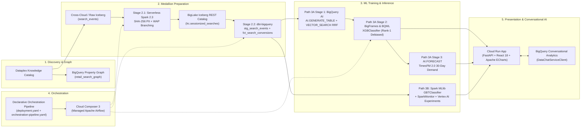

# 04 — Business Use Case, Architecture & Design Patterns

## 1. Business Use Case: Solving "The Long-Tail Conversion Desert"

In modern retail e-commerce, shopper search queries follow a power-law distribution across three tiers:
- **Head Queries (1–2 tokens, e.g., `"office chair"`)**: High volume, broad intent, well-served by traditional keyword matching (`BM25`), averaging **4.82% conversion rate (CVR)** and only a **2.7% zero-result rate**.
- **Torso Queries (3 tokens, e.g., `"walnut dining table"`)**: Moderate specificity, averaging **2.65% CVR** and an **11.5% zero-result rate**.
- **Long-Tail Queries (4+ tokens, e.g., `"ergonomic mesh home office chair under 300"`)**: Shoppers typing 4+ words have the **highest purchase intent**, yet legacy lexical search fails them in two ways:
  1. **Retrieval Failure (>30% Zero-Result Rate)**: Strict token matching fails when natural-language constraints (`"under 300"`, `"pet safe"`, `"low light"`) do not match literal product title strings.
  2. **Ranking Failure (1.10% CVR due to Historical Position Bias)**: High-converting specialty products (such as `SKU-1001` *AeroMesh Ergonomic Chair*) were historically buried at **Rank #7–#14**. Because shoppers rarely scroll past the top 3 results, raw click logs make buried items appear unpopular, trapping them on Page 2.

---

## 2. End-to-End Lakehouse & AI Architecture

---

## 3. Why Stage 2 Combines Serverless Spark (2.1) and `dbt-bigquery` (2.2)

Rather than treating Spark and `dbt` as mutually exclusive silos, enterprise lakehouse architectures use each engine where it excels over a shared **BigLake Managed Apache Iceberg REST Catalog (`lrc`)**:
- **Stage 2.1 — Serverless Spark (`02_preparation/alt_b_serverless_spark/`)**:
  - Reads raw cross-cloud telemetry (`search_events`) and performs **cryptographic SHA-256 PII pseudonymisation** (`pseudonymized_customer_id`, `pseudonymized_email_hash`, `pseudonymized_ip_hash`) at the Bronze boundary before raw PII ever reaches analytical tables.
  - Computes stateful 30-minute inactivity session windows (`clarity_session_id`) using PySpark `Window` functions.
  - Uses **Git-style Iceberg Table Branching (`audit_branch`)** to validate data quality before fast-forwarding `main`, plus **zero-scan metadata rollbacks (`CALL lrc.system.rollback_to_snapshot`)**.
- **Stage 2.2 — `dbt-bigquery` (`02_preparation/alt_a_dbt_dea/`)**:
  - Queries 4-part BigLake Iceberg tables in-place (zero data movement) and joins them with native BigQuery operational tables (`catalog_items`, `customer_clv`, `search_impressions`).
  - Materializes daily-partitioned, clustered Gold marts (`fct_search_conversions`) validated by native `dbt` 1.8+ `unit_tests:` and enriched with **Dataplex Knowledge Catalog Data Quality Scorecards**.

---

## 4. How `BigQuery AI` Functions & `BigFrames` (`XGBClassifier`) Work Together in Path 3A

Path 3A chains **three specialized AI/ML primitives** inside BigQuery:

1. **Candidate Retrieval & Intent Extraction (`AI.GENERATE_TABLE` + `VECTOR_SEARCH` RRF)**:
   - A gradient boosted tree (`XGBoost`) cannot parse raw natural language or retrieve products when keyword search returns 0 results.
   - `AI.GENERATE_TABLE` (Gemini 2.5 Flash) extracts structured attributes (`room_type`, `material_preference`, `style_tag`, `max_budget_usd`, `pet_safe_required`) from 4+ word tail queries.
   - `AI.GENERATE_EMBEDDING` (`text-embedding-005`) + `VECTOR_SEARCH` + `SEARCH()` fuse semantic and lexical rankings via **Reciprocal Rank Fusion (RRF)**, reducing the Tail Zero-Result Rate from **38.0% to 8.4%** and producing the `semantic_cosine_similarity` feature.
2. **Position-Debiased Conversion Re-Ranking (`BigFrames` `XGBClassifier` $\equiv$ `BQML` `BOOSTED_TREE_CLASSIFIER`)**:
   - Once 20 candidate SKUs are retrieved, ranking them by conversion probability requires a tabular model over commercial signals (`price_usd`, `average_rating`, `historical_item_ctr`, `customer_clv_segment`, `lexical_bm25_score`, `semantic_cosine_similarity`, `displayed_rank_position`).
   - `BigFrames` lets Python Data Scientists write `scikit-learn`/`pandas` syntax (`StandardScaler()`, `XGBClassifier.fit()`) that compiles 100% into in-warehouse BigQuery SQL (`CREATE MODEL ... BOOSTED_TREE_CLASSIFIER`) without calling `.to_pandas()`.
   - **Counterfactual Rank-1 Debiasing**: Training includes `displayed_rank_position` to absorb historical position bias; inference overrides `1 AS displayed_rank_position` for all candidates so every SKU is scored on a level playing field at Rank #1—lifting Tail CVR from **1.10% to 2.84% (+158.2% lift)**.
3. **Zero-Shot 30-Day Demand Forecasting (`AI.FORECAST` / TimesFM 2.0)**:
   - Projects 30-day post-reranking revenue and 95% confidence intervals across `head`, `torso`, and `tail` tiers in a single SQL query without manual `ARIMA_PLUS` model management.
